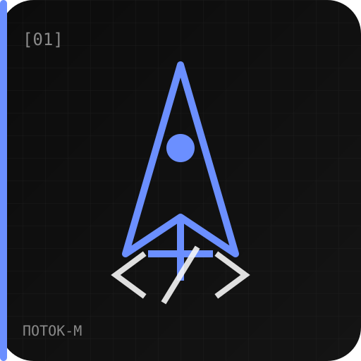

  

# rocket-team-m

Команда «Поток-М»: двухступенчатая ракета, бортовой ИИ-ассистент и открытый инженерный софт для стенда, симуляции и полёта.

Профиль организации; код живёт в отдельных репозиториях, этот репозиторий — только витрина команды.

## Репозитории

| Репозиторий | Назначение |
|---|---|
| [potok-m](https://github.com/rocket-team-m/potok-m) | документация, ADR, общие решения, сайт документации |
| [potok-m-ai](https://github.com/rocket-team-m/potok-m-ai) | обучение моделей, дистилляция, калибровка, бортовой инференс, A/B |
| [potok-m-sim](https://github.com/rocket-team-m/potok-m-sim) | 6-DoF симулятор, генератор данных, OR-parity, quality gates |
| [potok-m-protocol](https://github.com/rocket-team-m/potok-m-protocol) | UART-протокол, генератор биндингов, golden-тесты |
| [potok-m-firmware](https://github.com/rocket-team-m/potok-m-firmware) | прошивка STM32H743 на Rust/Embassy, safety interlocks |

## Принципы

- Безопасность важнее красивых метрик: ИИ не управляет двигателем и не трогает сервы напрямую.
- Каждое число в отчёте имеет конфиг, seed, дату и воспроизводимый прогон.
- Симулятор сверяется с OpenRocket как с oracle; расхождения фиксируются, а не затираются.
- Тяжёлые данные генерируются, а не хранятся в git.
- Открытая лицензия: MIT OR Apache-2.0; проприетарные SDK не используются.

## Сайт документации

[rocket-team-m.github.io/potok-m](https://rocket-team-m.github.io/potok-m/)

Логотип: `docs/logo.svg`, растровая версия `docs/logo.png`. Стиль — opencode.ai: near-black `#0c0c0c`, акцент `#6b8fff`, моно-индексы, тонкая сетка.
