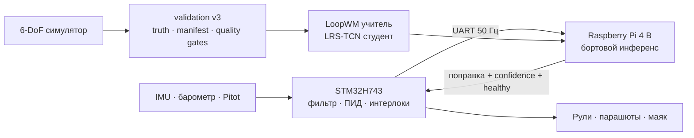

  

# rocket-team-m

Команда «Поток-М» делает двухступенчатую ракету и открытый стек вокруг неё: симулятор, протокол, прошивку, обучение бортового ИИ и инструменты для разбора полёта. Репозиторий профиля; код лежит отдельно.

## Что мы строим

Ракета быстрая, нестабильная и управляется в узком окне. На активном участке САС запрещена, поэтому ИИ не «пилотирует» ракету. Он наблюдает телеметрию на выбеге и спуске, предсказывает боковую перегрузку за 0,2–0,4 с и даёт STM32 ограниченную поправку. STM32 сохраняет вето: если поправка странная, код её не применяет, а при трёх пропусках отключает ассистента до конца полёта.

Это не маркетинговая «нейросеть в ракете». Это измеримая попытка удержать траекторию в порывах, где классический контур реагирует поздно.

## Репозитории

| Репозиторий | Что внутри |
|---|---|
| [potok-m](https://github.com/rocket-team-m/potok-m) | документация, решения, сайт, общие артефакты |
| [potok-m-ai](https://github.com/rocket-team-m/potok-m-ai) | модели, обучение, дистилляция, калибровка, edge-инференс, A/B |
| [potok-m-sim](https://github.com/rocket-team-m/potok-m-sim) | 6-DoF dynamics, wind/gust, generation dataset, OR-parity, quality gates |
| [potok-m-protocol](https://github.com/rocket-team-m/potok-m-protocol) | UART как единственный источник правды, генератор `.rs/.h/.py` |
| [potok-m-firmware](https://github.com/rocket-team-m/potok-m-firmware) | STM32H743, Rust/Embassy, safety FSM, watchdog |

## ИИ: как устроен наш стек

### 1. Данные и физика trước всего

Симулятор — не генератор «красивых чисел». Он сверяется с OpenRocket Simulation 9 как с oracle: апогей и vmax расходятся меньше чем на 2%, высота по времени — до 5%. Набор данных включает 14 физических признаков, 4 целевых канала и v3 truth sidecar: полное 6-DoF состояние, ветер, порыв, сдвиг и эталонную команду на каждом тике. Manifest фиксирует config hash, seed, split, сценарии, bounds и sha256 файлов; quality-gate падает на NaN, пересечение split и несовпадение размеров.

Полёт в наборе — 30 с при 50 Гц. ИИ активен после выгорания, примерно 920 тиков на эпизод. Рандомизация только внутри допусков «Поток-М»: масса 10,4–11,4 кг, $C_D$ в узком коридоре, ветер, порывы, задержки датчиков. Holdout — отдельные сценарии, не отдельные ракеты.

### 2. LRS-TCN — бортовая модель

В разговорной речи мы её называем RMS-TCN, в коде — `StatefulTCN`, LRS-TCN (low-rank stateful TCN). Ей не нужно окно на 50 кадров: она получает один кадр за тик и держит состояние между шагами.

$$
h_{t+1} = 0{,}8\,h_t + 0{,}2\,\mathrm{candidate}(x_t, h_t)
$$

Рекуррентные матрицы низкоранговые: $W = U V^\top$ с рангом 16 вместо плотных 64×64. Нормализация — RMSNorm. Веса рекурренции тернарные и деквантуются один раз при загрузке. На выходе — две поправки и confidence. ОграничениеCompute: около 59 тыс. MAC за кадр, 78 КБ весов; на Pi 4 B это microseconds, а не миллисекунды.

Почему не трансформер: на коротком окне проекции QKV на каждом кадре дороже, а выигрыша нет.

### 3. LoopWM — привилегированный учитель

LoopWM — не бортовая модель. Это офлайн-учитель: один parameter-shared блок многократно уточняет латентное состояние, число проходов зависит от нормы обновления, кап 6. Он видит истинный ветер и полное состояние, но только в функции потерь; на входе студента этого нет. Это линия RMA: привилегированная информация обучает, борт работает без неё.

Разработка идеи — [Looped World Models, arXiv:2606.18208](https://arxiv.org/abs/2606.18208). Мы не переносим числа «100× параметров» с языковых моделей; берём только параметрически общий блок и adaptive depth.

### 4. JEPA, MTP и дистилляция

Ученик JEPA с EMA-учителем предсказывает латент на 3/6/10 кадров вперёд по замаскированным кадрам, без реконструкции сырого сигнала. KoLeo мешает representations схлопнуться. MTP с K=3 даёт плотный сигнал по динамике ветра, но с малым весом, чтобы не выучить шум датчика. Затем LoopWM размечает поправки, а LRS-TCN учится на остаточной команде:

$$
u = u_{\mathrm{base}}(x) + \Delta_\theta(x), \qquad \mathcal{L} = \mathrm{MSE}(\Delta) + 0{,}05\,\mathcal{L}_{JEPA} + 0{,}02\,\mathcal{L}_{MTP}
$$

Источники: [TCN, arXiv:1803.01271](https://arxiv.org/abs/1803.01271), [RMA, arXiv:2107.04034](https://arxiv.org/abs/2107.04034).

### 5. Сжатие и оптимизация

TSCT — наша внутренняя технология, без публикации: низкоранговая спектральная параметризация $W=U\,\mathrm{diag}(s)\,V^\top$ с полярной ретракцией Ньютона–Шульца и квантизаторами на факторах. Мы её не выдаём за чужую статью. Тернарные факторы и 4-битные активации идут по линии [BitNet b1.58, arXiv:2402.17764](https://arxiv.org/abs/2402.17764), [Reloaded, arXiv:2407.09527](https://arxiv.org/abs/2407.09527) и [BitNet v2, arXiv:2504.18415](https://arxiv.org/abs/2504.18415); оптимизатор — Muon+ по [arXiv:2502.16982](https://arxiv.org/abs/2502.16982).

### 6. Калибровка и A/B

Confidence должен быть вероятностью, а не константой. isotonic/temperature map экспортируется в `calibration.json` и применяется и в Python, и в Rust. Порог adaptive compute берётся из калибровки, а не из 0,5. FINAL A/B считается по flown-truth sidecar: zero command против PID+ИИ, oracle как положительный контроль.

Статус честный: после исправления actuator mapping oracle дал −493 м по боковому RMS и +2236 м по апогею, а текущие студенты всё ещё хуже baseline. Причина найдена — модель училась на `g_theta`, а руль потребляет world-frame acceleration; сейчас target меняется на `g_accel`. Пока студент не обыграет zero command, ИИ в полёт не идёт.

## Протокол и борт

UART на 50 Гц: запрос STM32 → Pi, ответ Pi → STM32. Профиль lowlat — 42/16 байт, 2 Мбит/с; CRC16, seq, version, magic, фаза и флаги. Плохой кадр не вызывает модель; три пропуска отключают ассистента. Прошивка STM32 — Rust/Embassy, `no_std`, мок-HAL для хостовых тестов. Pi 4 B на 2 ГБ: fp32 может быть быстрее int4, потому что Cortex-A72 без ARMv8.2 dot-product; мерить на железе.

## Принципы

- Главное: безопасность важнее метрик; ИИ не трогает двигатель и сервы напрямую.
- Каждое число в отчёте имеет config, seed, дату и воспроизводимый прогон.
- Результат не подгоняется под желаемый вывод: красный тест остаётся красным.
- Тяжёлые данные генерируются и проверяются quality gates, а не лежат в git.
- Проприетарные SDK и код Dassault/Ansys не используются; лицензии MIT/Apache.

## Документация и статус

Сайт: [rocket-team-m.github.io/potok-m](https://rocket-team-m.github.io/potok-m/)

Логотип: `docs/logo.svg`, растровая версия `docs/logo.png`. Стиль — opencode.ai: near-black `#0c0c0c`, акцент `#6b8fff`, моно-индексы, тонкая сетка.
