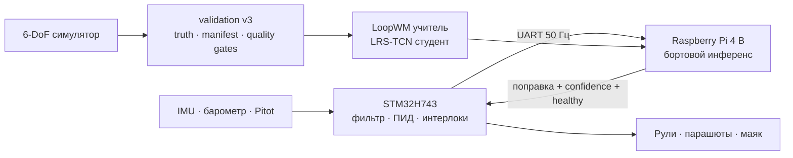

  

# rocket-team-m

Команда «Поток-М» делает двухступенчатую ракету и открытый стек вокруг неё: симулятор, протокол, прошивку, обучение бортового ИИ и инструменты для разбора полёта. Репозиторий профиля; код лежит отдельно.

## Что мы строим

Ракета быстрая, нестабильная и управляется в узком окне. На активном участке САС запрещена, поэтому ИИ не «пилотирует» ракету. Он наблюдает телеметрию на выбеге и спуске, предсказывает боковую перегрузку за 0,2–0,4 с и даёт STM32 ограниченную поправку. STM32 сохраняет вето: если поправка странная, код её не применяет, а при трёх пропусках отключает ассистента до конца полёта.

Это не маркетинговая «нейросеть в ракете». Это измеримая попытка удержать траекторию в порывах, где классический контур реагирует поздно.

## Репозитории

| Репозиторий | Что внутри |
|---|---|
| [potok-m](https://github.com/rocket-team-m/potok-m) | документация, ADR, общие решения, сайт |
| [potok-m-ai](https://github.com/rocket-team-m/potok-m-ai) | обучение моделей, дистилляция, калибровка, A/B |
| [potok-m-edge](https://github.com/rocket-team-m/potok-m-edge) | бортовой инференс на Raspberry Pi |
| [potok-m-sim](https://github.com/rocket-team-m/potok-m-sim) | 6-DoF симулятор, генератор данных, OR-parity |
| [potok-m-protocol](https://github.com/rocket-team-m/potok-m-protocol) | UART-протокол, генератор биндингов |
| [potok-m-firmware](https://github.com/rocket-team-m/potok-m-firmware) | STM32H743, Rust/Embassy, безопасность |
| [potok-m-3d](https://github.com/rocket-team-m/potok-m-3d) | 3D/CAD-модель, STEP/STL, аэродинамические входы |
| potok-m-workbench | приватный инженерный воркбенч, пока без кода |

## Принципы

- Главное: безопасность важнее метрик; ИИ не трогает двигатель и сервы напрямую.
- Каждое число в отчёте имеет config, seed, дату и воспроизводимый прогон.
- Результат не подгоняется под желаемый вывод: красный тест остаётся красным.
- Тяжёлые данные генерируются и проверяются quality gates, а не лежат в git.
- Проприетарные SDK и код Dassault/Ansys не используются; лицензии MIT/Apache.

## Документация и статус

Сайт: [rocket-team-m.github.io/potok-m](https://rocket-team-m.github.io/potok-m/)

Логотип: `docs/logo.svg`, растровая версия `docs/logo.png`. Стиль — opencode.ai: near-black `#0c0c0c`, акцент `#6b8fff`, моно-индексы, тонкая сетка.
